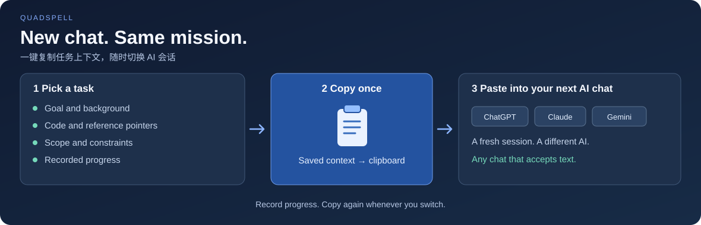

# QuadSpell · 四象咒言

**Switch AI chats. Keep your task context.**

One click copies your task brief and recorded progress. Paste it into the AI conversation you want to use next.

[Download for Windows](https://github.com/oin625/QuadSpell/releases/latest) · [macOS quick start](#get-started) · [简体中文](README.zh-CN.md)

[](https://github.com/oin625/QuadSpell/actions/workflows/windows.yml)
[](https://github.com/oin625/QuadSpell/actions/workflows/ci.yml)
[](LICENSE)



A conversation gets too long. You want another AI's opinion. You switch tasks, then return tomorrow.

QuadSpell keeps the goal, background, references, constraints, and progress together on your desktop. This reusable brief is a **spell**. Copy it once and paste it into ChatGPT, Claude, Gemini, a coding assistant, or any other chat that accepts text.

**Different AI. Fresh chat. Same task context.**

## Pick → Copy → Paste → Continue

1. **Prepare a task.** Write what you want to do, where the relevant code is, which materials may help, and any constraints.
2. **Copy in one click.** Use the card's **✦** button or **保存并复制咒言 (Save and copy spell)**. QuadSpell assembles the saved brief and progress into Markdown.
3. **Paste into the chat you choose.** Start a fresh session, switch providers, or return to another task with its saved context ready.
4. **Record progress before switching again.** Note what is done and what remains. The next copy includes those updates.

QuadSpell builds the clipboard text locally. **No API key, plugin, or provider setup is required.** You choose where to paste it.

| When you want to… | What you take with you |
| --- | --- |
| Start a fresh conversation | The task goal, references, and saved progress |
| Try a different AI | The same brief, ready to paste into its text input |
| Return to another task | That task's own context and recorded next steps |

Progress is recorded by you in QuadSpell. Referenced paths and links are included as pointers; attach the underlying files when your chosen chat needs their contents.

## What one copy carries

A spell combines your task title and project, background notes, code entry, reference pointers, goal, constraints, and recorded progress. Empty optional sections are omitted.

<details>
<summary>See a real copied example: switch chats with unfinished verification clearly recorded</summary>

This example was generated by QuadSpell's current copy function. The UI and generated section labels are currently in Simplified Chinese; task contents can be written in any language.

```markdown
# 需求：Fix search ordering

项目：Example app

背景与备注：
Keep the existing search filters.

## 代码入口
src/search.ts
请先定位并阅读相关实现。

## 可能有用的资料
docs/search-behavior.md
请按需查找并阅读。

## 要做什么
Sort search results by time. Preserve the current filters and verify empty results and tied timestamps.

## 补充说明
Limit changes to ordering. Continue with the remaining verification.

## 已记录的进度
- 2026/11/5 08:00:00：Sorting is implemented and the empty-results check passed. Tied timestamps and regression checks remain.
```

The next conversation receives both the requested change and the verification still to do.

</details>

## Choose the next task with four quadrants

The board helps you decide what deserves attention, then gives you the context to take it into a chat.

- Drag tasks between importance / urgency quadrants.
- Switch between the matrix and list views.
- Search tasks, projects, notes, and spells.
- Track status, deadlines, and progress history.

## Continue with the latest task state

- **Recover unfinished drafts.** New tasks, edits, pending progress, and change notes are saved locally as you type. Close or restart the app, then use the drafts menu to resume. Saving applies the draft; discarding removes only unsaved work.
- **Append changes without replacing the original goal.** Record this round's adjustments separately as C001, C002, and so on. The copied spell includes the original brief and all changes, with a reminder to retain unfinished verification.
- **Keep a structured handoff.** Manually record completed work, next steps, key decisions, and verification results. Once both next steps and verification are filled in, updating the summary covers progress through that save. Later progress is still copied. An incomplete summary keeps the full progress history in the copy; the editor always retains all history. Clearing the summary restores copying the full history.
- **Protect newer edits.** If the task or local data file changes while you are editing, saving stops and retains your draft. Copy any needed draft text, discard the old draft, then reopen the task to reconcile with the latest version.

Summaries are maintained by you. QuadSpell does not call an AI to summarize or mark unverified work as passed.

## Get started

**Windows x64:** [Download the latest release](https://github.com/oin625/QuadSpell/releases/latest). Choose `QuadSpell-Setup-*.exe` to install, or `QuadSpell-Portable-*.exe` to run without installation. The current binaries are unsigned, so Windows may display “Unknown publisher”.

**macOS 14+:** Install Swift 6 / Xcode Command Line Tools, then run the native app from source:

```bash
git clone https://github.com/oin625/QuadSpell.git
cd QuadSpell
swift run QuadSpell
```

The current desktop interface is in Simplified Chinese.

## Your task context stays local

Tasks are saved in a local JSON file:

| Platform | Data location |
| --- | --- |
| Windows | `%APPDATA%\QuadSpell\demands.json` |
| macOS | `~/Library/Application Support/QuadSpell/demands.json` |

Both versions use the same JSON format. Close the app before copying the file to the other computer. Each new installation starts with an empty board; synchronization is manual.

Version 0.3.0 writes schema version 2 and can read version 1 files. The first save upgrades the file while retaining existing tasks and progress. Older apps refuse to write version 2 files, protecting the new summaries and changes; update both apps before migrating data. Local drafts live separately in `drafts.json` alongside the task file and do not need to be copied when migrating tasks.

## Development

The repository contains a native SwiftUI app in `Sources/` and an Electron desktop app in `desktop/`.

```bash
# Native macOS tests
swift test

# Electron desktop app — Node.js 22
npm install --no-package-lock
npm start
npm run test:desktop
npm run smoke:desktop

# Build on Windows
npm run dist:win
```

Have a useful workflow for switching AI conversations? [Share it in an issue](https://github.com/oin625/QuadSpell/issues). Improvements to context handoff, usability, and language support are welcome.

[MIT License](LICENSE).
