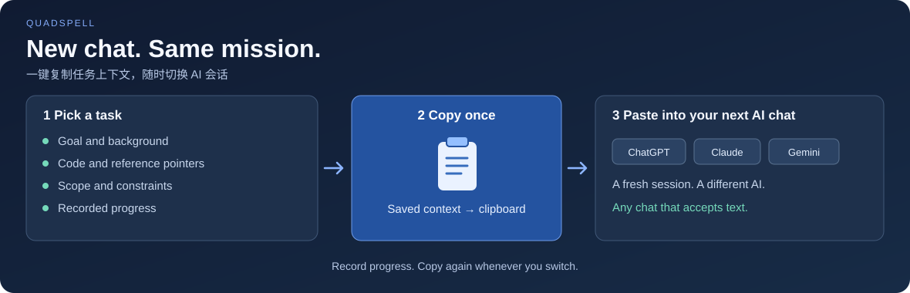

# QuadSpell · 四象咒言

**换 AI，换会话，任务接着做。**

一键复制任务上下文与已记录进度，粘贴到你想用的 AI 会话框里。

[下载 Windows 版](https://github.com/oin625/QuadSpell/releases/latest) · [macOS 快速开始](#开始使用) · [English](README.md)

[](https://github.com/oin625/QuadSpell/actions/workflows/windows.yml)
[](https://github.com/oin625/QuadSpell/actions/workflows/ci.yml)
[](LICENSE)



会话太长了，想开个新的；这次想换一家 AI；手上几项任务来回切，明天又要接着做。

QuadSpell 把目标、背景、资料线索、约束和进度放在任务里，组成一份可以反复使用的**「咒言」**。需要继续时，一键复制，直接粘贴到 ChatGPT、Claude、Gemini、编码助手，或任何支持文本输入的 AI 会话。

**任务上下文留在你手里，下一轮用哪家 AI，由你决定。**

## 选任务 → 一键复制 → 粘贴 → 接着做

1. **把任务交代清楚。** 写下要做什么、相关代码入口、可能有用的资料和补充约束。
2. **一键带走上下文。** 点击卡片上的 **✦ 咒言按钮**，或编辑器里的 **「保存并复制咒言」**，已保存的内容和进度会组装为 Markdown。
3. **随时换会话。** 粘贴到想用的 AI 里：换一家、开新会话，或切回另一项任务，都有现成的上下文。
4. **下一次切换前补一条进度。** 记下已完成什么、还剩什么，下次复制就会带上这次更新。

复制在本机完成，**无需配置 API Key、插件或 AI 供应商**。打开想用的会话框，粘贴即可。

| 你想做的事 | 一键带过去的内容 |
| --- | --- |
| 同一家 AI 开个新会话 | 任务目标、资料线索和已保存进度 |
| 换一家 AI 继续 | 同一份咒言，直接粘贴到它的文本输入框 |
| 从另一项任务切回来 | 这项任务自己的上下文和已记录的后续事项 |

进度由你在 QuadSpell 中记录。复制内容中的文件路径和链接是资料线索；所选聊天工具需要文件正文时，请一并附上相应文件。

## 复制出去的内容长什么样

咒言会带上任务标题与项目、背景备注、代码入口、资料线索、目标、约束和进度记录，未填的可选部分会省略。

<details>
<summary>看一个真实复制示例：新会话直接看到已完成什么、哪些验证还没做</summary>

以下内容由当前版本的复制函数生成：

```markdown
# 需求：修复搜索结果排序

项目：示例应用

背景与备注：
保留现有搜索过滤行为。

## 代码入口
src/search.ts
请先定位并阅读相关实现。

## 可能有用的资料
docs/search-behavior.md
请按需查找并阅读。

## 要做什么
让搜索结果按时间排序，保留现有过滤逻辑，并验证空结果与相同时间的排序。

## 补充说明
本次只修改排序，接续完成剩余验证。

## 已记录的进度
- 2026/11/5 08:00:00：排序已实现，空结果已验证；相同时间的排序与回归检查还未完成。
```

换一个会话，任务目标、修改范围和剩余验证仍然交代得清楚。

</details>

## 四象限帮你选下一件事

先按重要程度和紧急程度挑选任务，再把它的上下文一键带进会话。

- 拖动卡片调整象限，支持列表 / 四象限两种视图。
- 按标题、项目、备注或咒言搜索任务。
- 记录状态、截止日期和进度历史。

## 开始使用

**Windows x64：** [下载最新版本](https://github.com/oin625/QuadSpell/releases/latest)，选择安装版 `QuadSpell-Setup-*.exe` 或免安装版 `QuadSpell-Portable-*.exe`。当前安装包未签名，首次运行可能提示「未知发布者」。

**macOS 14+：** 安装 Swift 6 / Xcode Command Line Tools 后，从源码运行原生版：

```bash
git clone https://github.com/oin625/QuadSpell.git
cd QuadSpell
swift run QuadSpell
```

当前桌面界面为简体中文，任务内容可使用任意语言填写。

## 任务上下文保存在本机

数据保存为本机 JSON 文件：

| 平台 | 数据位置 |
| --- | --- |
| Windows | `%APPDATA%\QuadSpell\demands.json` |
| macOS | `~/Library/Application Support/QuadSpell/demands.json` |

两端使用同一种数据格式。迁移时关闭应用，再把文件复制到另一台电脑的对应位置。首次运行从空面板开始，同步由你手动完成。

## 开发与参与

`Sources/` 是 macOS 原生 SwiftUI 版，`desktop/` 是 Electron 桌面版。

```bash
# macOS 原生版测试
swift test

# Electron 桌面版，需要 Node.js 22
npm install --no-package-lock
npm start
npm run test:desktop

# 在 Windows 上打包
npm run dist:win
```

你是怎样在不同 AI 会话之间接续任务的？欢迎[分享使用场景](https://github.com/oin625/QuadSpell/issues)，一起改进上下文接续、交互和语言支持。

[MIT 许可证](LICENSE)。
